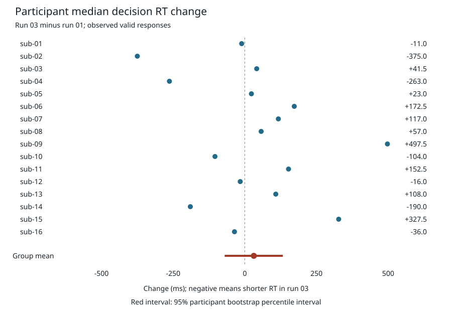

# Cohort first-to-third median decision RT change

Among 16 paired participants, the equal-participant mean change in median decision RT (run 03 minus run 01) was 31.344 ms; the 95% participant bootstrap interval was [-70.284, 132.658] ms. This describes temporal association among observed valid responses.

## Source and scope

OpenfMRI ds005 / ds000005 at `b094fc2f41487f92d382a1a432165ae58caae386`. README and dataset_description.json were read. The source declares BIDS 1.0.0rc4 and PDDL v1.0; no current BIDS validation was performed.

Citation: Tom, S.M., Fox, C.R., Trepel, C., Poldrack, R.A. (2007). The neural basis of loss aversion in decision-making under risk. Science, 315(5811):515–518. Acknowledge OpenfMRI and NSF Grant OCI-1131441 (R. Poldrack, PI), as requested by the source.

Observed inventory: 16 participants, 48 event TSVs, run counts {'01': 16, '02': 16, '03': 16}. Selected 32 run-01/run-03 files; 32 usable selected runs. Run 02 was audited only and does not enter the primary estimate.

## Method and paired results

RT comes from response_time in seconds and is converted to milliseconds. Retain only finite positive RT with (respnum,respcat) in {(1,1),(2,1),(3,0),(4,0)}. No contradictory fields are repaired. A run needs at least one retained RT. Each participant contributes one run-03 median minus run-01 median; the group is their equal-weight mean.

Participants are lexically sorted. For each interval endpoint independently, random.Random(20261014) generates 10,000 paired-participant bootstrap replicates, with n randrange(n) draws per replicate. Sorted means are linearly interpolated at (10000−1)p for p=.025 and .975. No hypothesis test was performed.

Included: sub-01, sub-02, sub-03, sub-04, sub-05, sub-06, sub-07, sub-08, sub-09, sub-10, sub-11, sub-12, sub-13, sub-14, sub-15, sub-16. Excluded: none.

| Participant | Run 01 n | Run 03 n | Run 01 median (ms) | Run 03 median (ms) | Change (ms) |
|---|---:|---:|---:|---:|---:|
| sub-01 | 85 | 85 | 1272.000 | 1261.000 | -11.000 |
| sub-02 | 84 | 82 | 1791.000 | 1416.000 | -375.000 |
| sub-03 | 86 | 85 | 1063.500 | 1105.000 | +41.500 |
| sub-04 | 83 | 85 | 1567.000 | 1304.000 | -263.000 |
| sub-05 | 21 | 79 | 1805.000 | 1828.000 | +23.000 |
| sub-06 | 86 | 85 | 965.500 | 1138.000 | +172.500 |
| sub-07 | 84 | 71 | 1167.000 | 1284.000 | +117.000 |
| sub-08 | 86 | 85 | 1076.000 | 1133.000 | +57.000 |
| sub-09 | 86 | 82 | 1252.500 | 1750.000 | +497.500 |
| sub-10 | 83 | 85 | 1785.000 | 1681.000 | -104.000 |
| sub-11 | 86 | 83 | 1398.500 | 1551.000 | +152.500 |
| sub-12 | 85 | 84 | 1701.000 | 1685.000 | -16.000 |
| sub-13 | 86 | 85 | 1179.000 | 1287.000 | +108.000 |
| sub-14 | 82 | 84 | 1625.000 | 1435.000 | -190.000 |
| sub-15 | 84 | 80 | 1624.000 | 1951.500 | +327.500 |
| sub-16 | 86 | 85 | 1154.000 | 1118.000 | -36.000 |



## Independent trial audit

Flags overlap; their sum is not an exclusion count. The union counts each excluded row once. Duplicate onsets flag later occurrences within a run; nonmonotonic onsets flag a decrease from the preceding valid onset. Onset flags are separate diagnostics and do not change the requested RT eligibility rule. No RT band variant is used.

| Flag/count | Runs 01 and 03 | All three runs (audit only) |
|---|---:|---:|
| trial_count | 2736 | 4096 |
| retained | 2618 | 3942 |
| missing_rt | 0 | 0 |
| invalid_numeric_rt | 0 | 0 |
| nonfinite_rt | 0 | 0 |
| nonpositive_rt | 117 | 153 |
| absent_response | 118 | 154 |
| unexpected_response_code_value | 0 | 0 |
| response_code_pair_disagreement | 0 | 0 |
| response_presence_disagreement | 1 | 1 |
| duplicate_onset | 0 | 0 |
| nonmonotonic_onset | 0 | 0 |
| invalid_onset | 0 | 0 |
| excluded_union | 118 | 154 |

The positive-RT absent-code row in sub-15/run-03, data row 1, is excluded by the general rule. It is flagged both absent_response and response_presence_disagreement. All per-trial raw RT/code strings and flags are retained in trial_audit.tsv; per-run counts and absence fractions are in run_summaries.tsv.

## Interpretation and limitations

- Run position is not randomized and task composition may differ. No causal practice, fatigue, learning, loss-aversion, or choice-preference inference is supported.
- The estimand concerns observed valid responses, not all offered decisions. Response codes are used only for presence; no correctness or acceptance meaning is inferred.
- Differential missingness is material: sub-05/run-01 has 65 absent-code rows among 86 trials (75.58%), versus 6 of 85 in run 03 (7.06%). The observed source has 154 absent-code rows overall and 118 in selected runs. The prompt wording suggesting 86 absent-code rows overall is not reproduced; 86 is the trial count for sub-05/run-01.
- No RT band was requested or applied; every positive finite RT with a recorded-response pair is retained, including very short RTs.
- Current BIDS validation, remote retrieval, fresh environment recreation, cross-platform replay, and independent-host replay were not attempted.
- Imaging payloads were neither read nor acquired. The existing Pixi lock targets osx-arm64; portability beyond this host is untested.
- Outer duct capture and native session capture are separate runner-managed evidence streams; their final records were not inspected here and no per-computation duct capture is claimed.
- Workshop feedback publication is unattempted because network access and external publication are prohibited for this run.

## Replay and research-object evidence

From the repository root, with the supplied local Pixi environment:

```sh
./code/replay.sh
```

The analysis uses only Python standard-library modules. A replay overwrites generated tables/reports; raw inputs are never written. Inventory and SHA-256 input hashes, machine-readable results, software versions, and an editable SVG accompany this report. A separate verification file records checks actually performed.

**self containment**: Local input event TSVs, metadata, analysis code, results, and executable replay are reachable from the top-level object. Untested: Fresh retrieval of all referenced components; imaging is outside analysis scope.

**trackability**: Pinned input revision plus SHA-256 for every event file and metadata file; row-level audit and software versions. Untested: No completeness claim for native or outer duct provenance; local transformation commit must be inspected separately.

**actionability**: ./code/replay.sh is the executable analysis specification; no analysis dependencies beyond the standard library. Untested: Independent-host replay.

**modularity**: Input subdataset, code, computed derivatives, and reports are separated. Untested: Reuse in another study.

**portability**: Relative analysis paths and existing versioned pixi.toml/pixi.lock; software versions recorded. Untested: Fresh environment build and non-osx-arm64 platforms.

**ephemerality**: Outputs are regenerable from code in the existing environment. Untested: Clean disposable environment recreation was not performed.

**distributability**: Source declares PDDL v1.0; requested citation and source attribution preserved. Untested: Persistent remote retrieval, publication, and license review of the complete software dependency bundle.

Completion: requested cohort computation and output generation completed. See reports/run.json and any separate verification evidence for actual checks and remaining limitations.

Verification: screening edge cases, independent raw-data medians and bootstrap, all source hashes, and same-host replay in a fresh output directory passed. All generated replay files were byte-identical before adding this verification record. No fresh environment or cross-platform replay was performed. Initial Workshop feedback recorder attempts failed because jsonschema was absent; recording recovered using the existing Workshop environment. No installation or external publication was attempted.

Provenance boundary: code and artifacts are saved in local Git commits. No DataLad run/rerun transformation record was created. Native capture remained enabled and outer duct capture belongs to the runner; neither final capture was inspected. The initial SVG was rendered and visually inspected. Replay uses standalone Snapper with an empty configuration because no active formatter pre-commit hook was present. Configuration files were not modified.
