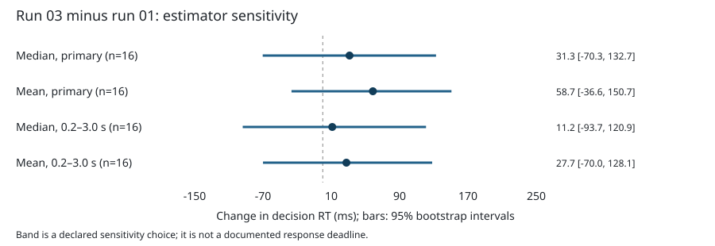

# Mixed-gambles RT: summarization sensitivity and run-02 context

Stage 03 completed locally.
Across the four declared estimators, equal-participant mean run-03 minus run-01 RT changes range from 11.16 to 58.70 ms.
This describes temporal association among observed valid responses; it does not establish causal practice, fatigue, learning, loss aversion, or choice preference.

## Data and screening

Source: OpenfMRI ds005 / OpenNeuro ds000005 at `b094fc2f41487f92d382a1a432165ae58caae386`.
All 48 local event TSVs and the README and dataset description were verified against that revision.
Source declares BIDS 1.0.0rc4; current BIDS validation was not attempted.
Raw inputs were unchanged.
Only event RT and response-presence codes determine retention; numeric codes are not interpreted as correctness or acceptance.

RT is read from `response_time` in seconds and reported in milliseconds.
Primary retention requires positive finite RT and a pair in (1,1), (2,1), (3,0), (4,0).
The inclusive 0.2–3.0 s band adds an RT filter and is not a documented deadline.
Independent flags may overlap; counts below cannot be summed to obtain exclusions.
Missing tokens are empty or case-insensitive n/a; parsing failure after removing those tokens is invalid numeric RT.
Unexpected codes include nonintegers, parsing failures, or out-of-domain values.
Pair disagreement is any pair outside the five permitted pairs including (0,-1).
Presence disagreement is the XOR of positive finite RT and a recorded-response pair.
Onset duplicates mean repeated values after their first occurrence; decreases are separately flagged and do not exclude RTs.

## Paired first-to-third endpoint

Each usable run has at least one retained RT.
Within each variant, per-participant change is run 03 minus run 01; the group estimate is the equal-weight mean of those paired changes.
Trials are never treated as independent participants.
Bootstrap: 10,000 paired participant replicates in lexical ID order, `random.Random(20261014)` restarted per variant, n draws with `randrange(n)` per replicate, and percentile interpolation at (9999 × p).
No hypothesis test was performed.

| Variant | Participants | Change (ms) | 95% percentile interval (ms) | Retained trials, all runs | Unique excluded, all runs |
| --- | ---: | ---: | --- | ---: | ---: |
| median_primary | 16 | 31.34 | [-70.28, 132.66] | 3942 | 154 |
| mean_primary | 16 | 58.70 | [-36.59, 150.72] | 3942 | 154 |
| median_band | 16 | 11.16 | [-93.72, 120.94] | 3904 | 192 |
| mean_band | 16 | 27.71 | [-69.96, 128.12] | 3904 | 192 |

Eligible IDs: sub-01, sub-02, sub-03, sub-04, sub-05, sub-06, sub-07, sub-08, sub-09, sub-10, sub-11, sub-12, sub-13, sub-14, sub-15, sub-16.
Eligible sets are identical across all four variants.
Common-intersection estimates are explicitly included in `results.json`.
Per-person run summaries, changes, and run-specific exclusion counts are in the TSV files.
All four point estimates are positive (longer observed RT in run 03), with appreciable magnitude sensitivity: the range is 11.16–58.70 ms.
Band filtering reduces the estimate for both summary statistics; mean-based estimates exceed median-based estimates here.
Every interval includes zero, so these intervals do not isolate a direction.
These are declared sensitivity variants; no variant is selected as preferable based on its numerical outcome.



## Intermediate-run context (separate from paired endpoint)

On the 16 participants with all three usable primary runs (sub-01, sub-02, sub-03, sub-04, sub-05, sub-06, sub-07, sub-08, sub-09, sub-10, sub-11, sub-12, sub-13, sub-14, sub-15, sub-16), equal-participant means of individual run medians are: run 01: 1401.62 ms, run 02: 1398.41 ms, run 03: 1432.97 ms.
These contextual values have no additional confidence interval and are not a trial-pooled endpoint.

## Trial audit and missing-response selection

4096 total rows across 48 event files.
All independent flags, including diagnostic band flags on primary rows:

| Flag | Rows |
| --- | ---: |
| missing_rt | 0 |
| invalid_numeric_rt | 0 |
| nonfinite_rt | 0 |
| nonpositive_rt | 153 |
| absent_response | 154 |
| unexpected_response_code | 0 |
| response_code_pair_disagreement | 0 |
| response_presence_disagreement | 1 |
| outside_rt_band | 191 |
| duplicate_onset | 0 |
| nonmonotonic_onset | 0 |

The first data row in sub-15/run-03 has positive RT and (0,-1) codes; it is excluded by the general rule, and its absence and presence-disagreement flags both remain visible. sub-05/run-01 has 65 absent-code rows among its 86 trials (75.6%); all runs together contain 154 absent-code rows.
The supplied 65-of-86 audit statement is interpreted with 86 as the run trial denominator, not the cohort absent-row total.
This concentration makes response selection a material limitation, especially for its first-run summary.
`missingness_by_run.tsv` gives all numerators and trial denominators.
The estimand is for observed valid responses, not every offered decision.
Run position is not randomized and task composition may differ; neither direction nor magnitude supports a causal practice, fatigue, learning, loss-aversion, or preference conclusion.

## Replay and evidence boundaries

From the research-object root, with the supplied existing Pixi environment:

```sh
pixi run --frozen python code/analyze_rt.py
pixi run --frozen python code/check_rt.py
pixi run --frozen python code/verify_replay.py
```

Analysis uses standard-library Python; DataLad supplies version metadata and the preinstalled host Snapper CLI formats the report.
Snapper is an explicit host dependency outside the supplied Pixi lock; its version is recorded, and no fresh installation was tested.
Software versions are in `software.json`; source hashes are in `source_hashes.json` and `reports/run.json`.
No dependency installation or fresh environment build was attempted.
No imaging data, containers, BIDS Apps, remote jobs, network retrieval, or external publication were used.
Native capture, the runner's outer duct record, and any local DataLad transformation commit are separate streams; no individual computation duct record is claimed.
The ongoing outer capture is not exported here.

Focused screening checks, an independent four-estimator recomputation, manifest hash verification, and a byte-identical repeat in the existing environment are documented in `verification.json`.
An initial check failed because it incorrectly treated 86 as the cohort absent-response count; the source recount resolved this denominator error.
A missing jsonschema module in host Python was bypassed using the preinstalled Workshop environment.
Neither issue required source modification.
DataLad executed the analysis with exit 0 and recorded the command and declared inputs/outputs.
Its execution record is preserved in `datalad-provenance.json`.
The commit subject was normalized to obey Conventional Commits; this removes the native DataLad parser prefix, so native `datalad rerun` recognition is unavailable.
The direct replay above is verified.

The following are bounded research-object observations, separate from scientific results, using the supplied offline STAMPED principles:

- **self_containment**: Local event TSVs, source metadata, code, tables, report, figure, Pixi manifest and lock are reachable here.
  Untested: Fresh retrieval and an independent reconstruction of the whole object.
- **trackability**: Pinned input Git revision; each consumed source file verified byte-for-byte against it and hashed; code and environment hashes recorded.
  Untested: Completeness of native capture and the ongoing outer duct capture.
- **actionability**: Executable analysis and replay command; tables and editable SVG generated locally.
  Untested: Replay on a separately provisioned host.
- **modularity**: Input subdataset, code/, derivatives/gambling-rt/, and reports/ separate inputs, computation, results, and interpretation.
- **portability**: Relative default paths; analysis uses Python standard library plus installed DataLad version metadata; supplied Pixi manifest and lock.
  Untested: Other platforms; supplied environment supports osx-arm64 only.
- **ephemerality**: Results are regenerated by a script without altering inputs.
  Untested: Disposable environment creation and clean-room rerun; existing local Pixi environment was reused.
- **distributability**: Source declares PDDL v1.0; requested attribution and source URL retained.
  Untested: Remote availability, publication, and third-party retrieval; no network access was used.

## Attribution

Tom, S.M., Fox, C.R., Trepel, C., Poldrack, R.A.
(2007).
The neural basis of loss aversion in decision-making under risk.
*Science*, 315(5811):515–518.
Data obtained from the OpenfMRI project, accession ds005; acknowledge OpenfMRI and NSF Grant OCI-1131441 (R. Poldrack, PI), as requested by the source.
Dataset source: https://github.com/OpenNeuroDatasets/ds000005.
Source declares Public Domain Dedication and License v1.0 (PDDL).
These source declarations are preserved without a new legal or BIDS conformance assessment.
