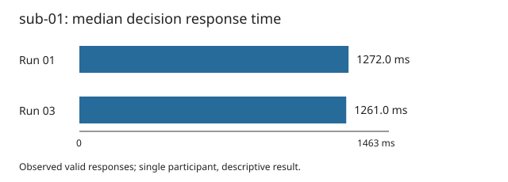

# Stage 01: sub-01 decision response times

For sub-01, run-03 minus run-01 median decision RT was -11.000 ms among observed valid responses. This is a descriptive temporal association for one participant; no population inference or causal interpretation is supported.

| Measure | Run 01 | Run 03 |
|---|---:|---:|
| presented_trials | 86 | 85 |
| retained_rt_count | 85 | 85 |
| excluded_row_union | 1 | 0 |
| median_rt_ms | 1272.0 | 1261.0 |
| missing_rt | 0 | 0 |
| invalid_numeric_rt | 0 | 0 |
| nonfinite_rt | 0 | 0 |
| nonpositive_rt | 1 | 0 |
| absent_response | 1 | 0 |
| unexpected_response_code_value | 0 | 0 |
| response_code_pair_disagreement | 0 | 0 |
| response_presence_disagreement | 0 | 0 |
| duplicate_onset | 0 | 0 |
| nonmonotonic_onset | 0 | 0 |
| invalid_onset | 0 | 0 |


RTs were read from `response_time` in seconds and multiplied by 1,000.
Each run median uses only finite positive RTs paired with (1,1), (2,1),
(3,0), or (4,0). Codes screen response presence only; they do not identify
correctness or the meaning of a choice. No rows were repaired. No RT band
was imposed. Every TSV data row counts as a presented trial.

Flags are independent and may overlap. Empty or `n/a` RTs are missing;
other parsing failures are invalid numeric RTs. Parsed NaN/infinity are
nonfinite; parsed values at or below zero are nonpositive (negative infinity
has both flags). Absent response
means respnum=0 or respcat=-1. Unexpected codes are unparsable, noninteger,
or outside the permitted domains. Pair disagreement means a tuple outside
the four recorded pairs and (0,-1). Presence disagreement is the exclusive
OR of finite-positive RT and a recorded pair. The excluded-row union counts
each excluded trial once. Duplicate onsets flag every member of a repeated
finite onset; nonmonotonic flags a strict decrease from the immediately
preceding finite onset. These onset flags do not exclude RTs. Raw values and
all flags are retained in `trial_audit.tsv` with one-based data-row numbers.



## Interpretation and omissions

- Single participant and two runs only; no population interval, hypothesis test, or generalization.
- Run position was not randomized and task composition may differ; no causal practice, fatigue, learning, loss-aversion, or preference claim.
- Estimand concerns observed valid responses, not every offered decision. No meaning or correctness inferred from choice codes.
- Task-supplied source audit reports 65 of 86 absent-code rows in sub-05/run-01. This differential missingness is a material dataset-level selection limitation; it was not independently re-audited in this sub-01-only stage.
- Task-supplied positive-RT absent-code case in sub-15/run-03 is outside this stage; the general rule excludes such contradictions without repair.
- Current BIDS validation, remote retrieval, clean-environment rebuild, alternate-platform replay, and DataLad run/rerun are unattempted. Local artifact saving is not a DataLad transformation record.
- No imaging data, downloads, dependency installation, containers, external services, or remote jobs used.

## Replay and provenance

From the research-object root, with the already installed environment:

```sh
pixi run --as-is bash code/replay.sh
```

The replay performs analysis and verification without installing dependencies.
Input SHA-256 digests, software versions, component digests and check states
are in `run.json`; computed values and units are in `results.json`.
Input contents are checked against Git commit `b094fc2f41487f92d382a1a432165ae58caae386` before analysis.
The source data remain unchanged. Native command output, the runner's one
outer duct record, and any DataLad transformation record are separate
evidence streams. The outer duct record was not inspected here; there is no
claim of one duct record per computation.

## Demonstrated research-object properties

**Self containment:** Local event inputs, source metadata, code, tables, report and environment specification are reachable from this working dataset. Untested: Fresh acquisition and full offline environment reconstruction.

**Trackability:** Pinned input revision and byte equality to Git blobs; SHA-256 input/component/output manifests and row-level audit. Untested: No complete lifetime provenance claim; any local DataLad transformation record must be inspected separately.

**Actionability:** Executable replay command provided; verification results recorded separately. Untested: Another user's independent replay.

**Modularity:** Input subdataset, code, derivatives and reports are separate components. Untested: Reuse in another pipeline.

**Portability:** Standard-library Python analysis, relative project paths and supplied Pixi manifest/lock; versions recorded. Untested: Other platforms and fresh builds; the supplied Pixi environment targets osx-arm64.

**Ephemerality:** Verification uses a temporary output directory when run. Untested: Disposable execution environment or clean-machine execution; existing local environment reused.

**Distributability:** Source declares PDDL v1.0 and attribution is preserved; portable text/vector outputs produced locally. Untested: Persistent third-party retrieval, publication, and independent availability.

## Source attribution

OpenfMRI project, accession ds005 (supplied as ds000005), Mixed-gambles task.
Acknowledgment: NSF Grant OCI-1131441 (R. Poldrack, PI).
Source README and dataset_description.json declare PDDL v1.0 and BIDS
1.0.0rc4. These declarations are not a current BIDS validation result.

Tom, S. M., Fox, C. R., Trepel, C., & Poldrack, R. A. (2007). The neural
basis of loss aversion in decision-making under risk. *Science*,
315(5811), 515–518. Citation transcribed from the source README.

## Verification

Passed 17 synthetic response-rule cases, independent Decimal median/count/change
checks, unchanged source hashes, and byte-identical local replay of all four
scientific output files in a temporary directory. This is same-environment
replay, not a clean rebuild or cross-platform test.
