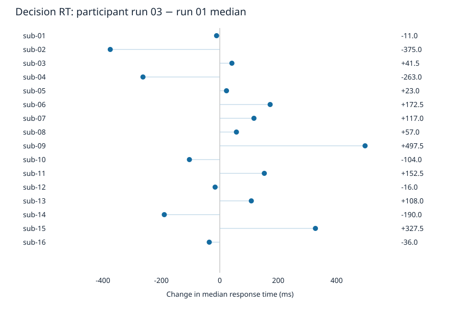

# Stage 02: paired median decision RT change

Across 16 paired participants, mean run-03 minus run-01 median decision RT was
31.34 ms (participant bootstrap 95% interval -70.28 to 132.66 ms).
This descriptive temporal association has heterogeneous participant changes and
does not establish causal practice, fatigue, learning, loss aversion, or choice
preference.

## Method and observed inventory

The pinned source contains 16 participants and 48 event TSVs.
Runs 01 and 03 contribute 32 usable runs.
All 16 participants (sub-01 through sub-16) are included; none are excluded.
Run 02 is audited for completeness but never enters the primary estimate.

Each run requires one valid response.
Retained RT is finite and positive and its response-code pair is one of (1,1),
(2,1), (3,0), (4,0).
Codes are used only for response presence; correctness, acceptance meaning and
choice preference are not inferred.
RT is read in seconds and summarized in milliseconds.
Group change is the equal-weight mean of participant changes, never a
pooled-trial analysis.

Bootstrap: 10,000 paired participant resamples in lexical participant order,
Python random.Random(20261014), n randrange(n) draws per replicate, RNG
restarted for each endpoint; sorted replicate means linearly interpolated at
9999*p for p=0.025 and 0.975.
No hypothesis test was performed.

## Participant results

| Participant | Run 01 retained | Run 03 retained | Run 01 median ms | Run 03 median ms | Change ms |
|---|---:|---:|---:|---:|---:|
| sub-01 | 85 | 85 | 1272.0 | 1261.0 | -11.0 |
| sub-02 | 84 | 82 | 1791.0 | 1416.0 | -375.0 |
| sub-03 | 86 | 85 | 1063.5 | 1105.0 | 41.5 |
| sub-04 | 83 | 85 | 1567.0 | 1304.0 | -263.0 |
| sub-05 | 21 | 79 | 1805.0 | 1828.0 | 23.0 |
| sub-06 | 86 | 85 | 965.5 | 1138.0 | 172.5 |
| sub-07 | 84 | 71 | 1167.0 | 1284.0 | 117.0 |
| sub-08 | 86 | 85 | 1076.0 | 1133.0 | 57.0 |
| sub-09 | 86 | 82 | 1252.5 | 1750.0 | 497.5 |
| sub-10 | 83 | 85 | 1785.0 | 1681.0 | -104.0 |
| sub-11 | 86 | 83 | 1398.5 | 1551.0 | 152.5 |
| sub-12 | 85 | 84 | 1701.0 | 1685.0 | -16.0 |
| sub-13 | 86 | 85 | 1179.0 | 1287.0 | 108.0 |
| sub-14 | 82 | 84 | 1625.0 | 1435.0 | -190.0 |
| sub-15 | 84 | 80 | 1624.0 | 1951.5 | 327.5 |
| sub-16 | 86 | 85 | 1154.0 | 1118.0 | -36.0 |

## Exclusion audit

Flags are independent and may overlap.
The unique union, not the sum of flag counts, is the number excluded.
Onset flags are reported separately and do not exclude trials.
No RT-band variant was used, so outside-band flags are not applicable.

| Flag / count | Selected runs 01 + 03 | All runs (audit only) |
|---|---:|---:|
| missing_rt | 0 | 0 |
| invalid_numeric_rt | 0 | 0 |
| nonfinite_rt | 0 | 0 |
| nonpositive_rt | 117 | 153 |
| absent_response | 118 | 154 |
| unexpected_response_code | 0 | 0 |
| response_code_pair_disagreement | 0 | 0 |
| response_presence_disagreement | 1 | 1 |
| duplicate_onset | 0 | 0 |
| nonmonotonic_onset | 0 | 0 |
| n_rows | 2736 | 4096 |
| n_retained | 2618 | 3942 |
| excluded_union | 118 | 154 |

The first data row of sub-15/run-03 has a positive RT and absent-response codes;
it is excluded by the general rule and flags both absent response and
response-presence disagreement.
Contradictory fields were not repaired.
All raw fields remain unchanged.

Differential missingness is substantial:
sub-05/run-01 has 65 absent-code rows out of 86 offered rows (75.6%), retaining 21; run 03 retains 79 of 85. The actual audit has 118 absent-code rows across selected runs and 154 across all runs. These observed denominators are retained explicitly. Trial-level overlapping flags and per-run missingness are in [trial_flags.tsv](../derivatives/gambling-rt/trial_flags.tsv) and [run_summary.tsv](../derivatives/gambling-rt/run_summary.tsv).

## Scientific limitations

- Run position was not randomized; task composition and response selection can
  differ across runs.
- The estimand concerns observed valid responses, not every offered decision;
  sub-05/run-01 retains 21/86 trials (65 absent-code rows).
- Small cohort of 16 participants; percentile bootstrap describes
  participant-level uncertainty without a hypothesis test.
- No RT-band sensitivity variant was requested or run.

## Replay and verification

Run `./code/replay.sh` from this dataset; see [README](../README.md).
Run `.pixi/envs/default/bin/python -I -S code/verify.py` for the retained
validation procedure.
Analysis uses only the Python standard library.

- 11 synthetic screening cases passed; overlapping conditions retained
- Independent Decimal summaries and weighted-index bootstrap endpoints agree
  within 1e-9 ms
- Every exclusion equals the unique flag union; sub-15/run-03 first data row
  excluded
- Fresh copied workspace and offline venv replay: all six derivative artifacts
  match SHA-256 exactly
- All source hashes unchanged after analysis and replay

The verification created a fresh copied input/code workspace and an offline venv
from the existing interpreter.
All six derivative SHA-256 values matched exactly.
This demonstrates same-host local replay, not fresh retrieval, reconstruction of
the full Pixi environment, cross-platform portability, or independent scientific
reproduction.
Optional schema import failed in two Python environments; an already installed
Workshop Python supplies jsonschema for the separate assessment check.

## Research-object evidence

Baseline: pinned data and environment definitions were supplied; no analysis
entrypoint or results existed.
Improvements are the protocol, explicit immutable inputs, executable analysis,
separated outputs, content manifests, numerical checks and fresh local replay.
Scientific validity is assessed separately from these properties.

| Property | Judgment | Evidence | Uncertainty / remaining gap | Smallest next step |
|---|---|---|---|---|
| Self-containment | partial | Essential event bytes, source metadata, scripts, and hashes are local. `code/source_manifest.json` | Python/OS binaries and complete license texts are not bundled. | Verify component retrieval and license coverage. |
| Trackability | partial | Pinned source commit, source/output SHA-256, executable parameters, and environment identity retained. `reports/environment.json` | No DataLad run/rerun transformation record; native and outer duct records uninspected. | Record a formal transformation and verify capture links. |
| Actionability | demonstrated | Executable replay and verification passed; six deterministic output digests match. `reports/verification.json` | Demonstrated only for locally available inputs on this host. | Attempt clean retrieval when authorized. |
| Modularity | demonstrated | Input subdataset stays immutable; code, computed outputs, and reports have explicit interfaces. `reports/protocol.md` | Independent module upgrade compatibility and license compatibility untested. | Test a deliberate module replacement separately. |
| Portability | partial | Relative paths, standard-library analysis, declared Pixi environment, and isolated Python invocation. `reports/environment.json` | Only the current macOS arm64 host tested; full lock restoration untested. | Replay on another supported host. |
| Ephemerality | partial | Fresh disposable workspace and offline venv produced identical retained outputs. `reports/verification.json` | Base interpreter and OS reused; no independently rebuilt runtime. | Rebuild an environment from the specification when authorized. |
| Distributability | unknown | Upstream URL, commit, PDDL declaration, and retained local files identify a distribution route. `inputs/ds000005/README` | Remote retrieval and persistent access were not tested; new code has no explicit license. | Establish licenses and test recipient retrieval before distribution. |

Assessment uses the pinned paper (310eefa…), principles 0.2.0 and checklist
0.3.1, with exact revisions and hashes in [assessment.json](assessment.json).
Paper T.4 includes component versions; checklist T.5 remains source-qualified.
Newer paper licensing criteria are retained as gaps, not silently translated.
All checklist items are preserved; unassessed ones remain unknown.
No aggregate STAMPED score or skill-efficacy claim is made.
[skill_use.json](skill_use.json) records actual reads and applications.

## Provenance, attribution and completion

Input: OpenfMRI ds005 / OpenNeuro ds000005, commit
`b094fc2f41487f92d382a1a432165ae58caae386`.
The source README and dataset_description.json declare PDDL v1.0 and BIDS
1.0.0rc4.
No current BIDS validation was run.
Acknowledge OpenfMRI and NSF Grant OCI-1131441 (R. Poldrack, PI).

Tom, S.M., Fox, C.R., Trepel, C., Poldrack, R.A.
(2007).
The neural basis of loss aversion in decision-making under risk.
*Science*, 315(5811):515–518.
Citation transcribed from the supplied README; no network lookup performed.

The shared run identifier is `mixed-02-treatment`.
Native capture and the whole-attempt outer duct wrapper are supplied
infrastructure, uninspected in this analysis.
No nested wrappers or per-computation duct records are claimed.
The input is a pinned DataLad subdataset; no DataLad transformation record was
created.

Completed the required cohort analysis and same-host verification.
Unattempted retrieval, current BIDS validation, full environment reconstruction
and external distribution remain explicitly untested.
All source hashes were unchanged.
