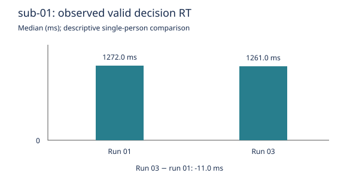

# Stage 01: sub-01 decision response times

Sub-01 median valid decision RT changed from 1272 ms in run 01 to 1261 ms in run 03 (run 03 minus run 01: -11 ms). This is a descriptive temporal association in one person.

| Run | Presented trials | Retained RTs | Excluded-row union | Median RT (ms) |
|---|---:|---:|---:|---:|
| 01 | 86 | 85 | 1 | 1272 |
| 03 | 85 | 85 | 0 | 1261 |

All exclusion flags are independent; counts can overlap.

| Flag | Run 01 | Run 03 |
|---|---:|---:|
| absent_response | 1 | 0 |
| duplicate_onset | 0 | 0 |
| invalid_numeric_rt | 0 | 0 |
| invalid_onset | 0 | 0 |
| missing_rt | 0 | 0 |
| nonfinite_rt | 0 | 0 |
| nonmonotonic_onset | 0 | 0 |
| nonpositive_rt | 1 | 0 |
| response_code_pair_disagreement | 0 | 0 |
| response_presence_disagreement | 0 | 0 |
| unexpected_response_code | 0 | 0 |

Run 01 data row 1 has RT=0, respnum=0, respcat=-1. Its two flags
refer to one excluded row. Run 03 has no excluded rows. No RT-band variant
was requested. Onset flags are separate audits and do not exclude trials.



The protocol in `protocol.md` preceded summary calculation. It defines the
finite-positive RT and recorded-response-pair rule, units and estimand.
Every trial and raw response field is retained in `trial-audit.tsv`.

Verification passed: independent Decimal medians and denominators for both
runs, 15 synthetic flag cases, all four source hashes matching pinned Git
bytes, and exact SHA-256 agreement for five outputs after replay in a fresh
temporary directory from a local clone. The existing interpreter was reused.
The temporary directory was removed. See `verification.json`.

Replay from the object root:

```sh
pixi run --frozen python code/analyze_rt.py
pixi run --frozen python code/verify_rt.py
```

`code/build_report.py` rebuilds this reporting layer and reads the explicitly
supplied frozen skill paths; those treatment references are assessment inputs,
not dependencies of scientific replay. `skill-use.json` records actual reads
and concrete applications; it does not claim all hashed tree files were read.

## Scientific limitations

- Single-person descriptive temporal association; no population interval or generalization.
- Run position is not randomized and task composition may differ; no causal practice, fatigue, learning, loss-aversion or choice-preference inference.
- Estimand concerns observed valid responses, not every offered decision. No correctness or acceptance meaning is inferred from numeric codes.
- Task-supplied broader source audit reports 65 of 86 absent-code rows in sub-05/run-01. This is a material differential-missingness warning, not recomputed here; only sub-01 runs 01 and 03 were analyzed.
- Task-supplied positive-RT absent-code row in sub-15/run-03 was not inspected; the general rule excludes such contradictions.
- Source declares BIDS 1.0.0rc4; current BIDS validation was not attempted.
- Fresh external retrieval, fresh software construction, cross-platform replay and independent reproduction were not attempted.

## Research-object evidence

Baseline had pinned inputs and environment definitions, but no implemented
analysis, trial audit, replay evidence or report. The following reassessment
uses the same seven criteria from the protocol; there is no aggregate score.

| Property | Judgment | Observed evidence | Remaining gap / next step |
|---|---|---|---|
| Self-containment | partial | Selected input bytes, code, reports and Pixi definitions are within this root. | Software is preinstalled; new code license unresolved. Assign code license and test clean software restoration. |
| Trackability | partial | Pinned source commit, SHA-256 inventories, code/environment identity and local transformation records. | Native/outer duct artifacts are not inspected or independently linked by path. Audit the retained capture streams with authorization. |
| Actionability | demonstrated | Analysis and verification commands executed; five output digests matched in a fresh local working directory. | Only the named same-host, existing-interpreter replay is established. Test a fresh environment when authorized. |
| Modularity | demonstrated | Separate input subdataset, code, derivative outputs and reports; CLI accepts input/output paths. | Independent component updates have not been tested. Test another explicitly selected input revision separately. |
| Portability | partial | Relative analysis paths, standard library code, pinned Pixi environment; observed macOS arm64 runtime. | No cross-platform or freshly constructed environment test. Rebuild on another authorized host. |
| Ephemerality | partial | Temporary replay directory was removed after comparison; durable results and checks retained. | Software interpreter was reused, not reconstructed in a fresh environment. Run in a newly constructed disposable software environment. |
| Distributability | partial | Source retrieval URL, exact revision and source PDDL terms retained; outputs prepared locally. | No external retrieval or publication; new code license unresolved. Resolve component licenses and verify recipient retrieval when authorized. |

Paper revision 310eefa1bd756a04d69161c216d93af4d354dd05 was consulted
offline at its normative property sections; principles 0.2.0 and checklist
0.3.1 were supplied offline. Their pinned SHA-256 values were verified.
The paper adds licensing criteria and puts component versions in T.4; the
older data/checklist uses T.5. No silent mapping or latest-version claim is made.
Detailed unreviewed assessment and all checklist responses are retained.
Schema validation failed because jsonschema was unavailable in both attempted
interpreters. The checklist export helper did run successfully. These failures
are recorded in failures.json and do not invalidate the scientific checks.
Workshop recording likewise lacked jsonschema; local skill-use evidence is
retained, with no claim that it was queued or published.

## Attribution and execution boundaries

OpenfMRI ds005 (ds000005), NSF Grant OCI-1131441 (R. Poldrack, PI).
Tom, S.M., Fox, C.R., Trepel, C., Poldrack, R.A. (2007). The neural basis of
loss aversion in decision-making under risk. *Science*, 315(5811):515–518.
Source declares PDDL v1.0 and BIDS 1.0.0rc4; its README and
`dataset_description.json` are preserved unchanged. No MRI content was used.

Run ID: mixed-01-treatment. Native capture, the supplied single outer duct
wrapper, and local DataLad transformations are separate evidence streams.
No native histories or outer logs were inspected. No computation is claimed
to have its own duct record. No network, other arm, agent or external message
was used. A local DataLad run records the explicit transformation command.
Stopping condition: stage 01 scientific outputs and scoped verification complete.
Fresh retrieval/environment/platform checks remain unattempted.

The automatic DataLad commit subject was normalized to Conventional Commits. The original DataLad message and parsed transformation remain in reports/datalad-run-message.txt and reports/datalad-transformation.json. Native datalad rerun requires its leading subject marker and is not the replay entry point for this normalized commit; use the tested executable replay commands.
